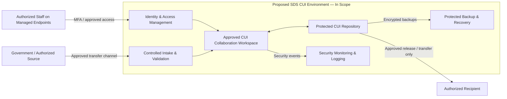

# Proposed CUI Data Flow — Conceptual

The diagram illustrates a **hypothetical** CUI workflow. All boundaries, platforms, and connections are assumptions to be validated; no live systems or real CUI are represented.

## Interfaces to validate
1. Government-to-contractor intake and marking verification.
2. Managed device and identity enforcement (MFA, RBAC, session controls).
3. Approved repository and collaboration permissions.
4. Approved outbound sharing and recipient validation.
5. Monitoring, retention, and backup protections.
6. External providers and shared-responsibility dependencies.

## Exclusions
Public marketing website and unapproved third-party portals must not receive CUI.
