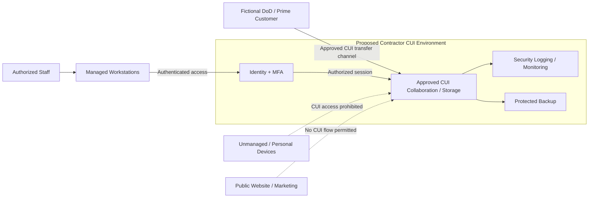

# High-Level System Boundary and CUI Data Flow

**Status:** Conceptual architecture — not a validated network diagram. All components and flows are simulated.

## Interpretation

- Solid arrows represent **illustrative intended** business or security flows, not proof of implementation.
- Dashed arrows represent prohibited flows.
- Identity, monitoring, and backup services are included as potential security protection assets; their exact scoping must be verified.
- The fictional customer transfer interface requires explicit review of contractual handling and approved methods.

## Open boundary questions

1. Which exact cloud offerings and service configurations are approved for the simulated CUI workload?
2. Are security monitoring, identity, and backup services dedicated or shared with corporate IT?
3. Which subcontractors or external service providers touch or protect CUI?
4. Where are CUI exports, printouts, and local caches stored?
5. What endpoint and physical safeguards apply to remote users?

These questions feed the Day 2 asset inventory and data-flow validation.
